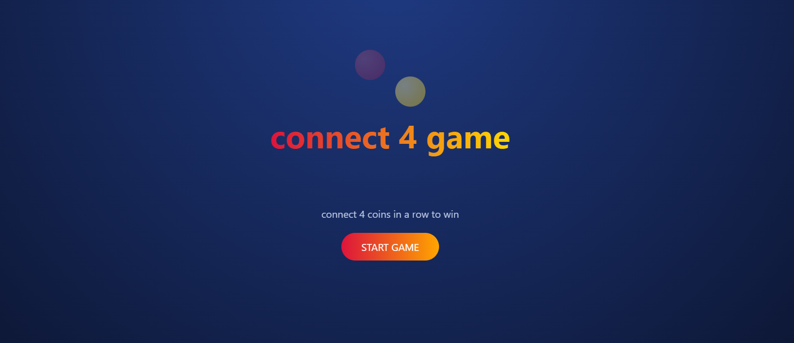
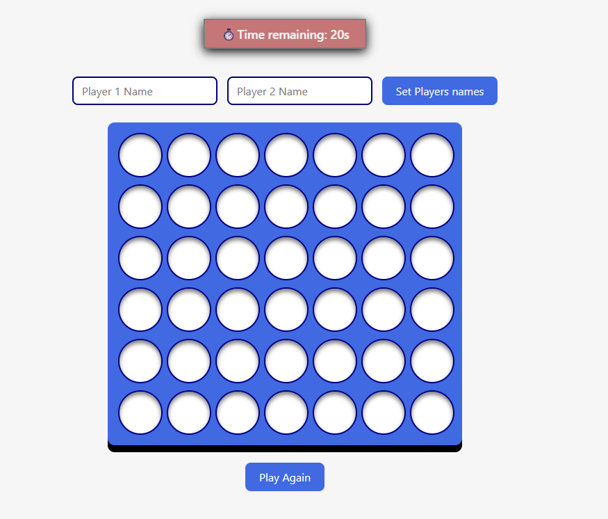
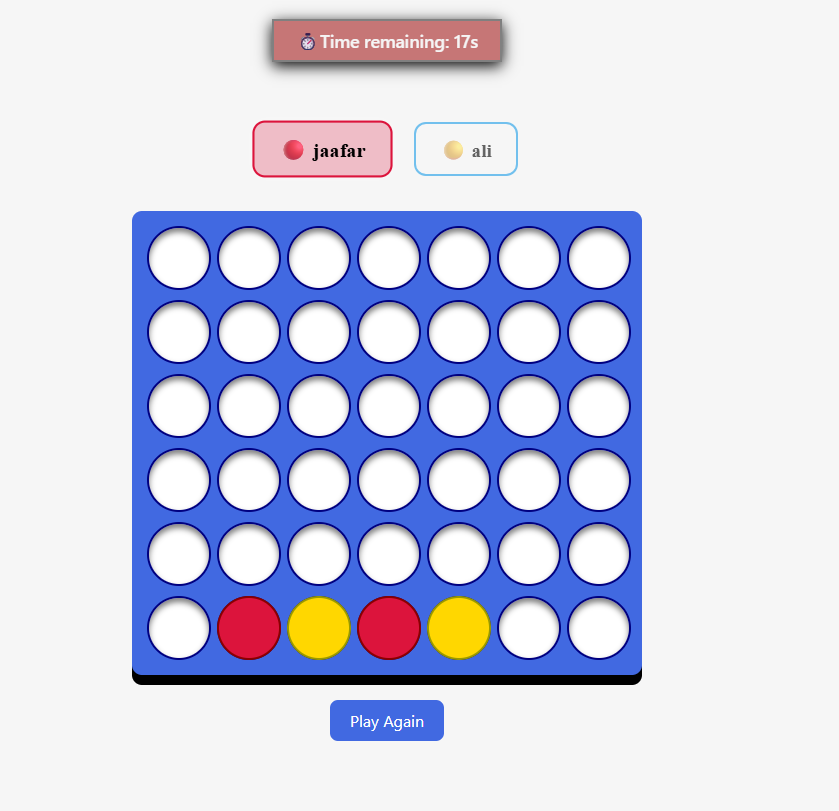
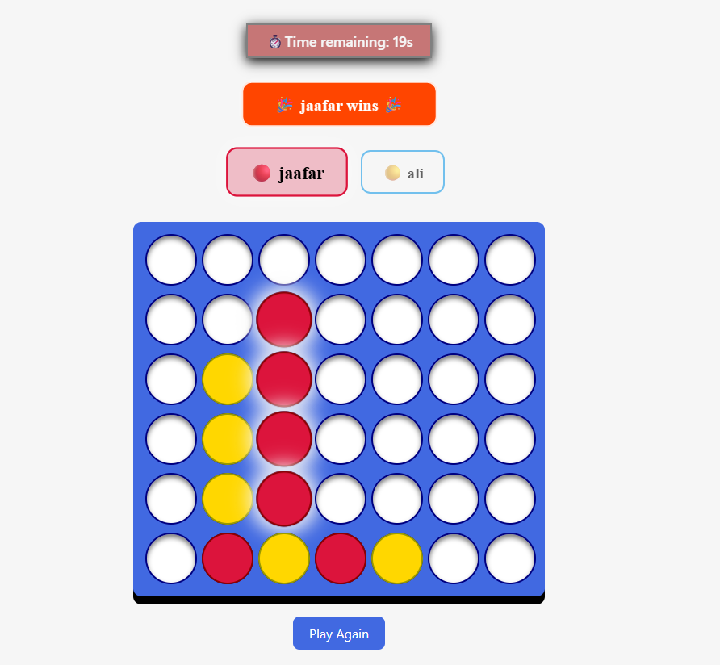

# Project Name : connect 4 game
## Technologies Used :
- html
- css 
- java script
## Description
1.The game is played on a 6-row by 7-column grid

2.Players take turns dropping their colored discs

3.discs fall straight down, occupying the lowest available space
## User Stories
-player wins when they align 4 of their discs consecutively in any direction:
   * Horizontally↔️
   * Vertically  ↕️
   * Diagonally(Upwards or Downwards) ↗️ ↘️
   f all 42 spaces are filled and neither player has 4 discs in a row, the game ends in a draw.
## Screenshots

## Future Enhancements
- add a player vs computer
- add a wins best of 3
## Credits
- sounds from youtube
